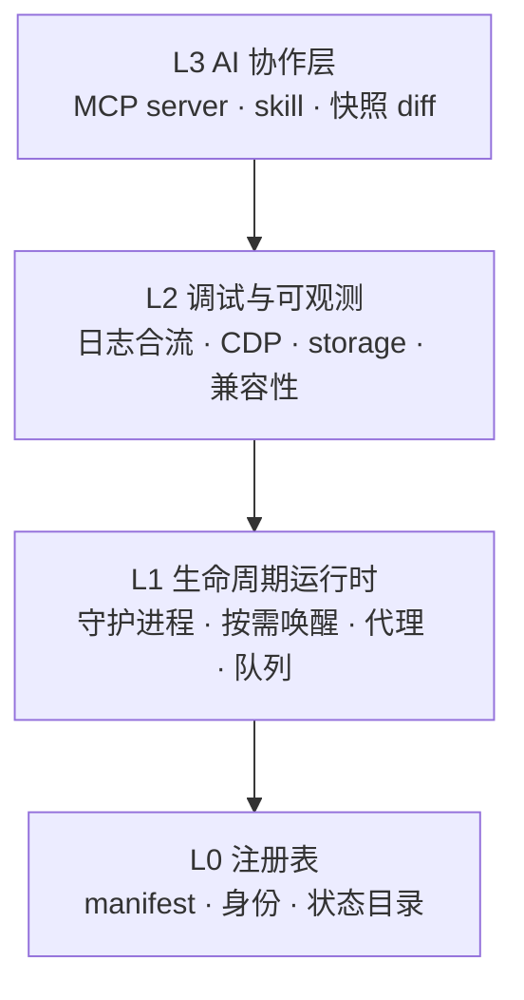
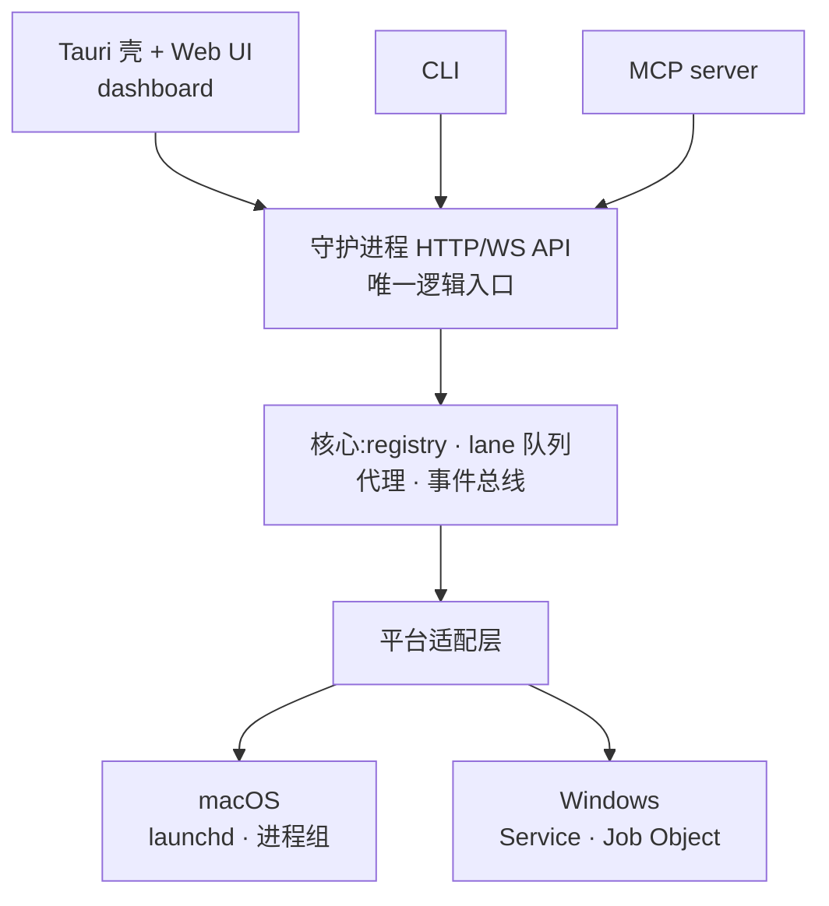

# 本地 App 管理器:边界与功能分析

2026-09-19 · @Someone

## 定位与反定位

一个常驻本地的 app 注册表与生命周期管理器:让你自己写的小 web app 不开终端就能跑起来,并把它们的运行状态结构化地交给 AI 调试。

可证伪的验收标准只有一条:**装上之后的一个月里,你不需要为启动或调试自己的 app 打开任何终端。** 任何功能如果不服务于这一条,就进延后区。

明确不是什么——这几条是后续所有取舍的依据:

- **不是部署平台。** 不管远程主机、不管容器编排、不管 HTTPS 证书和域名签发。范围止于这台机器的 localhost。
- **不是 agent 运行时。** 不跑 LLM 循环、不管 agent 会话与对话历史。它给 agent 提供 MCP 工具和上下文,自己不做决策。
- **不是通用浏览器自动化工具。** 浏览器能力全部绑定到已注册的 app,不提供"随便开个网页操作一下"的入口。这既是边界也是安全设计。
- **不是脚手架生成器。** 不生成项目模板、不替你选框架。只对已经存在的项目做登记和托管。
- **不是 IDE 插件。** 独立进程,不依赖任何编辑器,也不与编辑器竞争。

一个判断准则,后面反复会用到:**凡是 AI 天然擅长、且只需要文本接口的事,做成约定和文件,不要做成界面。**

## 现有方案与真空地带

你想做的东西里,有一半已经有成熟实现了。直接集成,不要重写。

| 方案 | 它解决的 | 它不管的 | 对你的意义 |
| --- | --- | --- | --- |
| [local.vibe](https://github.com/graiz/local.vibe) | 本地 app 的 `.vibe` 域名、dashboard、按需启停、`vibe.json` 配置 | 调试、快照、AI 集成、跨平台(仅 macOS) | 你的 L1 已有参考实现,先装一次验证假设 |
| [chrome-devtools-mcp](https://github.com/ChromeDevTools/chrome-devtools-mcp) | 50+ 工具:console(带 source map 栈)、network、performance trace、heap snapshot、设备模拟 | **cookie / localStorage / 缓存清理**;不知道谁是谁的 app | 直接依赖,不自研 CDP 封装 |
| [Playwright MCP](https://stevekinney.com/writing/driving-vs-debugging-the-browser) | 跨引擎驱动(Chromium/Firefox/WebKit)、稳定的自动化语义 | 深度诊断信息较弱 | 兜底浏览器兼容性检查 |
| [OpenClaw](https://docs.openclaw.ai/) | Gateway 守护进程、session 隔离、lane 队列、markdown skill、多唤醒源 | 管的是 agent 不是 app | 架构模板,逐层映射 |
| Docker Desktop / Portainer | 容器生命周期与可视化 | 非容器化的裸进程项目(你大部分 app) | 参考 UI 范式,不是竞品 |

这张表给出三个结论:

1. **L1(生命周期)有参考但无跨平台方案**——local.vibe 只管 Mac,而你 Windows 和 Mac 都要。这是个真空位。
2. **浏览器调试本身已经商品化**——Google 官方在做,你没有任何理由在这一层竞争。
3. **真正空的格子只有两个**:storage/cookie/cache 的 MCP 覆盖,以及——更重要的——**浏览器信息与后端进程日志的身份绑定与时间轴对齐**。

第 3 条是整个项目的唯一技术护城河。现有所有 browser MCP 面对的都是"无主的浏览器"——agent 得被告知开哪个 URL,而且看不见后端。只有拿着 registry 的人能把“前端报了 500”和“同一毫秒后端抛了这个栈”拼到一条时间轴上。

## 四层边界模型

把你提的功能按依赖方向摄成四层。**上层可以依赖下层,反向依赖一律视为设计错误。** 这条规则是边界收敛的主工具:任何让你想“从 L1 反过来调 L3”的功能,设计一定出了问题。

| 层 | 职责 | 输入 | 输出(对上层的契约) |
| --- | --- | --- | --- |
| **L0 注册表** | 回答“有哪些 app、它们是什么” | 项目目录里的 manifest 文件 | 结构化 app 描述 + 稳定的 app id |
| **L1 运行时** | 回答“让它跑起来、停下来” | app id + 唤醒事件 | 进程句柄、端口、stdout/stderr 流、健康状态 |
| **L2 可观测** | 回答“它现在怎么了” | L1 的进程流 + 浏览器会话 | 统一时间轴的事件流 + 可查询快照 |
| **L3 AI 层** | 把下三层包成 agent 能用的东西 | L2 的事件流 + L0 的描述 | MCP 工具、skill 文件、快照 diff |

### 每层的关键设计点

**L0** 是整个系统的地基,而且它应该由 AI 写。你在 `CLAUDE.md` 里加一条“新项目必须生成 app.toml”,比事后做智能发现可靠一个数量级。自适应扫描(扫 `package.json`、`docker-compose.yml`、猜端口)只能作为**首次导入的草稿生成器**,生成完让人确认一次就落盘成文件——绝不能做成每次启动都重新猜。

**L1** 参照 OpenClaw 的 Gateway:单进程、多路复用一个端口、状态唯一真相源。并发模型直接拄 lane 队列:**每个 app 一条队列、队列内串行、队列间并行**。这条不是优化是必需——同一个 app 上“重启 + 跑 smoke test + 清缓存”并发执行必然出乱。

**L2** 的唯一价值是**关联**,不是采集。每条事件必须带 `(app_id, instance_id, 单调时钟戳, source)` 四元组,source 取值 `backend_stdout | browser_console | network | health`。有了这四元组,时间轴对齐是自然结果;没有,你就只是又一个日志收集器。

**L3** 只是一层薄封装。它不应该有业务逻辑——所有能力都已经在 L1/L2 以 HTTP API 形式存在,MCP server 只是把它们映射成工具描述。这条约束保证了 CLI、dashboard、MCP 三个入口行为一致。

## 功能逐条裁决

你提过的全部功能,加上推导出的几项。判定分三档:**核心**(不做产品不成立)、**延后**(该做但不是现在)、**砍掉**(不该以这个形态存在)。

| 功能 | 层 | 判定 | 理由与替代形态 |
| --- | --- | --- | --- |
| manifest 规范 + 注册 | L0 | 核心 | 所有其他功能的地基。先做这一件 |
| 自适应发现 | L0 | 核心(降级) | 降为首次导入的草稿生成器,人工确认后落成文件 |
| dashboard 一键启停 | L1 | 核心 | 就是“不开终端”这条验收标准本身 |
| 开机自启 | L1 | 核心(改形) | **只自启守护进程**,app 按需唤醒 + 空闲回收 |
| 统一入口 / 端口代理 | L1 | 核心 | 按需唤醒的触发器,不只是个便利 |
| 前后端日志合流 + 时间轴对齐 | L2 | 核心 | 唯一护城河。别人做不了 |
| 接入 chrome-devtools-mcp | L2 | 核心 | 直接依赖官方实现 + 绑定 app 身份 |
| storage / cookie / cache MCP | L2 | 核心 | 官方的空白区,且是高频调试操作 |
| 快照 + diff | L2 | 核心 | 比“迁移指导”具体一个数量级 |
| MCP 注入控制 | L3 | 核心 | 中央 registry + 按 app 授权 + 调用日志 |
| skill / 提示词指导 | L3 | 核心(改形) | 是 app 目录下的 markdown 文件,**不是 GUI** |
| 跨引擎 smoke test | L2 | 延后 | 依赖 manifest 里的关键路径声明,得等 L0 稳定 |
| 图标创建 | L0 | 延后 | 先用 favicon 抓取 + 首字母兑底,够用了 |
| 迁移 / 兼容性指导 | L3 | 延后 | 快照 diff 做出来之后它自然就有了材料 |
| 本地域名(`.vibe` 类) | L1 | 延后 | 权限最麻烦的一步。`localhost:端口` + 跳转先扑上 |
| **统一 sqlite 入口(共享写)** | — | **砍掉** | 改为各 app 自持 db + 只读聚合浏览器 + 统一备份 |
| **GUI 配置编辑器** | — | **砍掉** | manifest 是文本,让 AI 改。做成表单是倒退 |
| **自研 CDP 封装** | — | **砍掉** | 官方 50+ 工具已存在,重写是纯损失 |
| **通用浏览器自动化入口** | — | **砍掉** | 越过 app 边界,同时是安全灾难 |
| **容器编排 / 远程部署** | — | **砍掉** | 反定位已经排除 |

### 两个值得展开的改形

**开机自启→按需唤醒。** 二三十个 Node 进程开机常驻会吃光内存和电池,用户第一天就卸载。正确形态:常驻的只有守护进程(几十 MB),它占住端口与入口,收到第一个请求才拉起目标 app,空闲 N 分钟自动回收。体验上“开机就能点开”,代价约等于零。

**统一 sqlite → 只读聚合。** SQLite 即使开 WAL 也只允许一个写者,多个 app 写同一文件会互锁,而且一个 app 写坏 schema 全军覆没。保留你想要的价值(一个地方看所有数据、统一备份、跨 app 查询),去掉风险:**各 app 自持 db 文件,管理器只提供只读的聚合浏览器、统一备份与迁移工具。**

## 必须划死的五条线

这五条都是“看起来该做”的设计。写在这里是因为每一条都会在开发中期重新诱惑你一次。

**1. 不碰用户日常的浏览器 profile。** 那里面有银行和邮箱的会话。每个 app 分配独立的、可丢弃的 profile。这条一旦破例,产品就从开发工具变成了凭据窃取工具。

**2. 不做共享写入的统一数据库。** 理由见上节。只读聚合能拿到 90% 的价值和 0% 的风险。

**3. 不把配置做成表单。** manifest 和 skill 都是文本文件,放在 app 目录里,跟着 git 走。dashboard 只负责**展示和校验**,不负责编辑。理由:你的目标用户(包括你自己)都有 AI,改文本比填表快。做表单是把 AI 擅长的事手工化了。

**4. 不重写浏览器调试层。** 只做两件事:把 `chrome-devtools-mcp` 绑定到具体 app,以及补齐它空的 storage/cookie/cache 工具。其余一律转发。

**5. 不提供“任意 URL”入口。** 所有浏览器操作必须带 app id,且目标 origin 必须在该 app 的 manifest 声明内。这既是安全边界,也恰好是你相对通用 browser MCP 的正当卖点——scoped。

一条元规则:**凡是为了“顺手也能用”而破开的口子,都会同时损失定位清晰度和安全边界。** 上面五条里有四条本质上是同一条。

## 架构骨架与跨平台分叉

结论先放:**约 95% 的逻辑是跨平台的,真正分叉的只有三处。** 把这三处隔离到一个适配层里,双平台就不是风险。

三个入口全走同一套 API——这是前面“L3 不带业务逻辑”那条约束的落地形式,也顺带保证了 AI 能做的事你手动也能做。

### 真正分叉的三处

| 分叉点 | macOS | Windows | 难度 |
| --- | --- | --- | --- |
| 自启注册 | launchd plist | Windows Service 或计划任务 | 低,各约 200 行 |
| 进程树管理 | 进程组 + SIGTERM | **Job Object** | **高,坑在这里** |
| 域名与端口 | hosts / 本地 DNS | hosts(需管理员) | 中,可延后 |

**进程树这一项必须展开说**,因为它是这类工具在 Windows 上最常见的 bug。你的 app 典型形态是 `npm run dev` → `npm` → `vite`,三层进程。macOS 上设个进程组然后 SIGTERM 整组就干净了;Windows 上**必须用 Job Object**,否则杀了父进程留下孤儿进程占着端口,用户得重启电脑才能解决。这块不要用现成的 Node 库糊,老实调 API。

### 选型建议

核心编成单文件守护进程(Rust 或 Go),UI 用 Tauri 共用一套 web 前端。**不要 Electron + 两套原生代码**——那就是“两边都做一半”的标准死法。

OpenClaw 把设备相关逻辑做成**轻量外设节点、经 WebSocket 接入核心**,这正好回答了边界该划在哪里。你的平台适配层按同一思路设计:核心不知道自己跑在哪个系统上。

## 安全边界

你要做的东西是**常驻守护进程 + 本地 HTTP 接口 + 交给 AI 的 cookie 权限**。这三样凑在一起正是 OpenClaw 被安全圈盯上的原因——微软安全团队和 Vectra 都发过分析,后者标题直接叫“当自动化变成数字后门”。

你的攻击面比它小,但是同一类。下面六条现在加是几十行,出事之后再加是重构。

| 约束 | 具体做法 | 不做的后果 |
| --- | --- | --- |
| 守护进程鉴权 | gateway token + origin 校验,只监听 ​`127.0.0.1` | 任意网页能跨域控制你所有 app |
| cookie/storage 作用域 | 按 app 的 manifest origin 白名单硬锁 | AI 一条指令读走任意站点凭据 |
| 浏览器 profile 隔离 | 每 app 独立、可丢弃;永不附用户日常 profile | 银行、邮箱会话暴露给 agent |
| 凭据存储 | 进系统钥匙串 / Credential Manager | 明文 token 满盘走 |
| 第三方 skill | 当不可信输入,默认不自动加载 | 提示词注入 + 供应链攻击 |
| 写操作确认 | 清缓存、改 cookie、删数据默认需确认 | AI 误操作不可逆 |

两个值得单独强调的点。

**cookie 作用域是产品特性不是限制。** 通用 browser MCP 给 agent 的是整个浏览器;你给的是“这个 app 声明过的 origin”。写进官网第一屏:**不会让 agent 碰到你的银行 cookie。**

**守护进程的端口是真实攻击面。** 它能启动任意进程、读任意日志。任何网页都能向 `127.0.0.1` 发请求,所以 origin 校验和 token 不是可选项。

参考:[Running OpenClaw safely — Microsoft Security](https://www.microsoft.com/en-us/security/blog/2026/02/19/running-openclaw-safely-identity-isolation-runtime-risk/) · [When Automation Becomes a Digital Backdoor — Vectra AI](https://www.vectra.ai/blog/clawdbot-to-moltbot-to-openclaw-when-automation-becomes-a-digital-backdoor)

## 里程碑与收敛路径

每个里程碑都需要一个**能让你停下来重新评估的验证标准**。这类项目最常见的死法是元项目吞噬项目——花三个月做管理器,管三个应用。验证点就是防这个的。

| 里程碑 | 交付物 | 验证标准(达不到就停下来) |
| --- | --- | --- |
| **M0** manifest 规范 | `app.toml` 字段定义 + 校验器 | 手写三个存量 app 的 manifest 不别扭;AI 能根据规范自动生成 |
| **M1** 运行时 | 守护进程 + 代理 + 按需唤醒 + 极简 dashboard | **连续一周启动自己的 app 没开过终端** |
| **M2** 可观测 | 日志合流 + 接入 chrome-devtools-mcp + 时间轴 | 拿一个真 bug,AI 靠这条时间轴定位到根因 |
| **M3** 补齐与包装 | storage/cookie MCP + 快照 diff + MCP 注入控制 | 一次真实的版本回归,靠 diff 找出差异 |

### 为什么是这个顺序

**M0 先行有个隐性好处**:规范一定,你就可以立刻让 AI 在每个新项目里顺手生成 manifest。等 M1 写完时,你已经有一批存量 app 处于可被管理状态——这段时间是白赚的。

**M1 做完你自己就能用了。** 这是整个计划里最重要的一条:它保证了即使后面全部停掉,你也已经收回了成本。如果 M1 做完一周后你发现自己还是习惯性地开终端,**那这个产品的基本假设就是错的**,此时停损比任何时候都便宜。

**M2 是卖点成立的那一步。** M1 结束时你只是个启动器(local.vibe 已经是了),M2 结束时才有东西是别人没有的。所以如果要对外发布,**不要在 M1 发**。

**M3 全部是可拆的。** 这三项之间没有依赖,可以按当时的实际痛点挑着做。

### 一个诚实的前提检查

你提到“本地项目很多但同时跑起来的很少”。这句话里有个值得警惕的信号:如果大部分项目平时根本不跑,那么“开机自启”和“统一管理”的真实价值就比想象中小。

所以 M1 的验证标准要认真执行:**如果你一周内只启动了两三次 app,说明痛点在调试不在启动**。那就应该把 L1 压缩到最小(能启停就行、不做域名不做图标),把重心全部移到 L2/L3——产品从“本地 app 管理器”变成“**AI 友好的全栈调试器**”。这是个完全不同但可能更锐的定位。

## 留给你拍板的开放问题

下面六条我无法替你决定,但每一条都会改变后续的实现路径。附上我的值倾向。

| 问题 | 选项 | 我的倾向 |
| --- | --- | --- |
| **定位重心** | 启动器为主 / 调试器为主 | 调试器——启动器有竞品,调试器没有 |
| **自用还是产品** | 只给自己 / 开源 / 商业化 | 先自用到 M2,再决定——现在决定信息不足 |
| **manifest 格式** | `app.toml` / `app.json` / 复用 `vibe.json` | 复用 local.vibe 的 `vibe.json` 并扩展,免得分裂生态 |
| **后端语言** | Rust / Go / Node | Rust(Tauri 原生、单文件、进程控制库成熟) |
| **MCP 形态** | 独立 MCP server / 守护进程内置 | 内置——少一个进程,而且天然拿得到 registry |
| **支不支持容器化 app** | 支持 / 不支持 | 支持,但只当作一种 adapter,不做编排 |

### 最关键的一条

第一行决定其他五行。两种定位会长成不同的东西:

**启动器为主** → 重心在 L0/L1,要做域名、图标、开机自启、好看的 dashboard。竞品是 local.vibe。差异化靠跨平台。

**调试器为主** → 重心在 L2/L3,dashboard 可以丑,但时间轴、快照 diff、MCP 工具要做透。竞品是通用 browser MCP。差异化靠**前后端关联 + app 身份绑定**。

两者共用 L0 和 L1 的骨架,所以 M0 和 M1 怎么都不会白做——**这个决策可以推迟到 M1 结束**。到那时你会有一周的真实使用数据,比现在拍脑袋靠谱得多。

## Sources

- [local.vibe](https://github.com/graiz/local.vibe) · [作者说明](https://gregraiz.com/blog/local-vibe/)
- [chrome-devtools-mcp](https://github.com/ChromeDevTools/chrome-devtools-mcp) · [Chrome 官方介绍](https://developer.chrome.com/blog/chrome-devtools-mcp)
- [Playwright vs. Chrome DevTools MCP](https://stevekinney.com/writing/driving-vs-debugging-the-browser)
- [OpenClaw Architecture — Control Plane, Sessions, Event Loop](https://theagentstack.substack.com/p/openclaw-architecture-part-1-control) · [架构经验总结](https://blog.agentailor.com/posts/openclaw-architecture-lessons-for-agent-builders) · [官方文档](https://docs.openclaw.ai/)
- [Running OpenClaw safely — Microsoft Security](https://www.microsoft.com/en-us/security/blog/2026/02/19/running-openclaw-safely-identity-isolation-runtime-risk/) · [Vectra AI 分析](https://www.vectra.ai/blog/clawdbot-to-moltbot-to-openclaw-when-automation-becomes-a-digital-backdoor)
